# Release readiness

This checklist records the local release-candidate review of October 19-20, 2026. Repository tags
`v0.1.0` and `v0.1.1` exist; the current source has moved beyond them. This page does not establish
App Store Connect or TestFlight submission status, and documentation validation does not release anything.

## Identity and version

| Item | Current value | Status |
| --- | --- | --- |
| Display name | `DashPilot` (app product name; explicit widget display name) | Retained pending identity approval |
| App bundle identifier | `quang.DashPilot` | Preserve for existing installations |
| Widget extension identifier | `quang.DashPilot.Widgets` | Preserve |
| Marketing version | `1.0` (Xcode's default, never chosen) | Reconcile with the next approved release version |
| Build number | `1` (`CURRENT_PROJECT_VERSION`) | Confirm against submission history before distribution |
| Deployment target | iOS 26.5, all targets | Ready |
| Device family | iPhone and iPad (`TARGETED_DEVICE_FAMILY = 1,2`) | Retained; physical-device checks outstanding |
| Signing team | set in the project; no signing in CI | Unchanged by design |

**Version.** The repository has `v0.1.0` and `v0.1.1` tags, while Xcode still declares `1.0`.
The proposed next repository milestone is `v0.2.0`, under DashPilot unless a different name is
separately approved. Before distribution, explicitly approve the matching marketing version and
a build number valid for the actual submission history. No version, tag or release changed in this review.

**Name approval.** Worklane remains a working name with material conflicts. The preliminary
October 19 investigation found a live pending US class 042 application,
[WORKLANE, serial 99594941](https://tsdr.uspto.gov/#caseNumber=99594941&caseSearchType=US_APPLICATION&caseType=DEFAULT&searchType=statusSearch),
and existing [Worklane](https://apps.apple.com/us/app/worklane/id6758229814) and
[WorkLane](https://apps.apple.com/gb/app/worklane/id6786815326) business apps. This is not legal
clearance. Keep DashPilot's shipping name and artwork until the owner resolves the conflict and
separately approves a public identity. Concept artwork is not a shipping asset.

**Bundle identifier.** Preserve `quang.DashPilot` and `quang.DashPilot.Widgets`. A cosmetic rename
must not become a new application or lose access to its existing sandbox. Keep module and target
names, model identities, frozen schemas, default store configuration, onboarding preference keys,
intent types and Live Activity attribute types unchanged.

**iPad.** The app retains iPad support. Representative simulator journeys and layout captures exist;
they do not establish landscape, multitasking, physical-device VoiceOver or App Store screenshot
completeness. A submission still needs its required device-specific screenshots.

## Assets and appearance

- **App icon:** one 1024-point universal icon with dark and tinted variants
  (`Assets.xcassets/AppIcon.appiconset`). Ready.
- **Launch appearance:** generated (`UILaunchScreen_Generation`), the system background. Ready.
- **Typeface:** the system face; neither the app nor the widget bundles a font
  (`FontBundleInvariantTests`).
- **Accent:** adaptive blue `AccentColor`, shared with Live Activity roles; see the [design system](design-system.md).

## Capabilities and configuration

| Capability | Where it is declared | Status |
| --- | --- | --- |
| Location, When In Use | `NSLocationWhenInUseUsageDescription` | Ready. No Always key exists, by design |
| Background location | `UIBackgroundModes = [location]` in `DashPilot/Info.plist`, the only mode | Ready |
| Live Activities | `NSSupportsLiveActivities = YES` in `DashPilot/Info.plist` | Ready. No push, no entitlement needed |
| Widget extension | `DashPilotWidgets.appex`, embedded by the app target | Ready |
| App Intents | nine discoverable intents, nine App Shortcuts; eight Live Activity intents, not discoverable | Ready |
| Entitlements | none; no App Group, no iCloud, no push | Ready |

The location purpose string says what the app does and no more: it records the route of a shift the
driver started, keeps recording while they use other apps or the screen is locked, and keeps the
route on the device. **A store reviewer will ask why a background mode is declared**; the answer is
the one in [Location](../architecture/location.md): capture started with the app open continues off
screen, and nothing starts or relaunches the app in the background.

## Privacy, as a submission would describe it

Every statement below is true of the code as it stands. None is broader than the implementation.

- **Accounts:** none. There is no sign-in and no server.
- **Network:** DashPilot contains no networking code. Nothing it records leaves the device except
  in a file the driver exports and shares themselves.
- **Analytics, telemetry, advertising, tracking:** none. No third-party SDK of any kind.
- **Data stored on the device:** shifts and their times, pauses and parked stretches, deliveries and
  their lifecycle times, the route positions captured while a shift runs, pickup-place names the
  driver typed, earnings, tips, expected pay and expenses the driver entered, vehicle profiles and a
  gas price. Work records are in the app's own SwiftData store. The onboarding completion version is an app-local `UserDefaults` preference.
- **Location:** used only while a shift the driver started is running, When In Use only, continuing
  in the background once started with the app open. Positions are stored to measure recorded
  mileage; the standard export carries distances and never coordinates.
- **Live Activity:** shows the shift's state, working time, recorded mileage, counts and each open
  delivery's clock. It shows no amount, no pickup name, no address and no coordinate, because a Lock
  Screen can be read by anyone beside the phone.
- **App Intents:** perform the same lifecycle actions as the buttons, against the same local store.
  Nothing is donated to the system.
- **Export:** JSON and CSV, written only when the driver asks, handed to the system share sheet,
  and removed from the temporary directory at the next launch.
- **App Privacy label:** with nothing collected (in Apple's sense, sent off the device), the label
  would be "Data Not Collected". Confirm against the questionnaire at submission time.
- **Privacy manifest:** `DashPilot/PrivacyInfo.xcprivacy` declares no tracking, no collected data
  types and app-local `UserDefaults` access for the onboarding completion version using `CA92.1`.
  This matches [Apple's required-reason API guidance](https://developer.apple.com/documentation/bundleresources/app-privacy-configuration/nsprivacyaccessedapitypes/nsprivacyaccessedapitypereasons).
  Source review found no direct use of the other required-reason API categories. Confirm the built
  archive's privacy report and App Privacy questionnaire before any submission; a simulator build
  is not App Store validation.

## Product positioning

DashPilot is a local-first companion for delivery drivers on any platform. It is not affiliated with
DoorDash or any other delivery platform, it does not read, scrape or automate any delivery app, and
the in-app wording is platform neutral (see [Platform terminology](platform-terminology.md)). The
README, the docs and the Acknowledgements screen name DoorDash only to disclaim an integration.
**The name contains "Dash"**, which a reviewer or a platform could read as an association; that is a
naming decision for the owner, recorded here rather than made here.

## Licenses

DashPilot's source is MIT (`LICENSE`). The app has no third-party runtime dependency and bundles no
font, so the Acknowledgements screen lists the MIT license and the system typeface and nothing
else. The documentation toolchain (MkDocs) is a build-time dependency only.

## Documentation and screenshots

- README shows the current Home, Work and Money workspaces with links into this site.
- Permanent images are unaltered iPhone 17 simulator captures from the reviewed source, taken on
  October 19-20, 2026 using Xcode 27.1 and iOS 26.5. They use synthetic fixtures or records entered
  through UI journeys and a 9:41 status bar. No real earnings, places, customers or routes appear.
- UI journeys retain their original 40-test scope. Additional light/dark, narrow-phone, AX5 and
  iPad evidence stays outside the repository. Diagnostic extreme-value captures are not marketing images.
- All captures retain DashPilot. After an approved identity change, recapture any affected screens,
  especially onboarding, Settings, permission explanations, delivery disclaimers and export presentation.
  These documentation images are not a complete App Store screenshot submission.
- A release-notes draft is in [Release notes draft](release-notes-draft.md).

The main workspaces and reports:

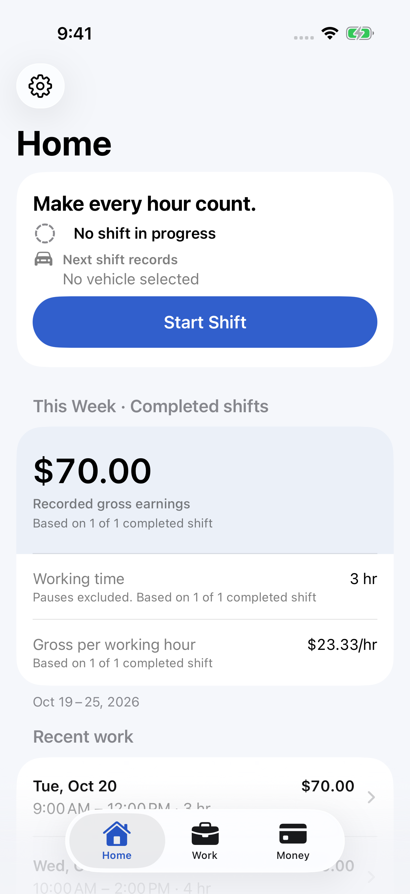{ width="200" }
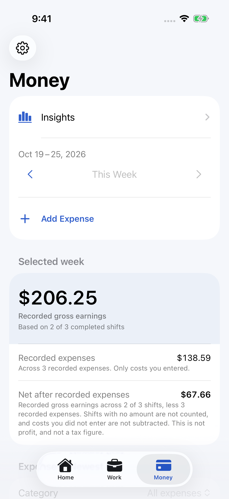{ width="200" }
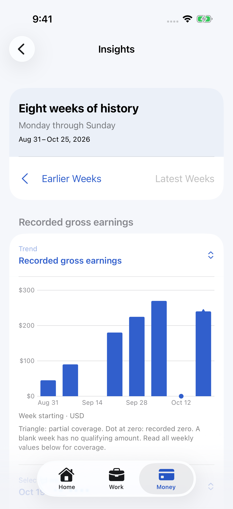{ width="200" }
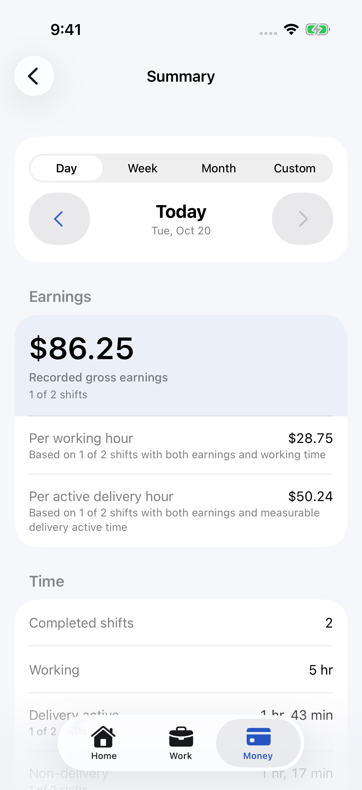{ width="200" }
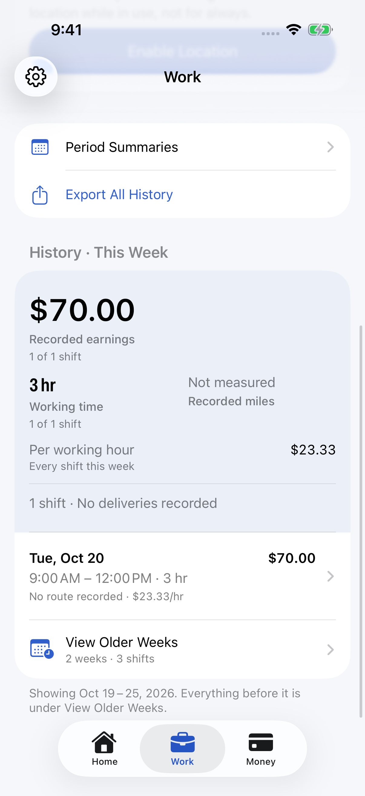{ width="200" }
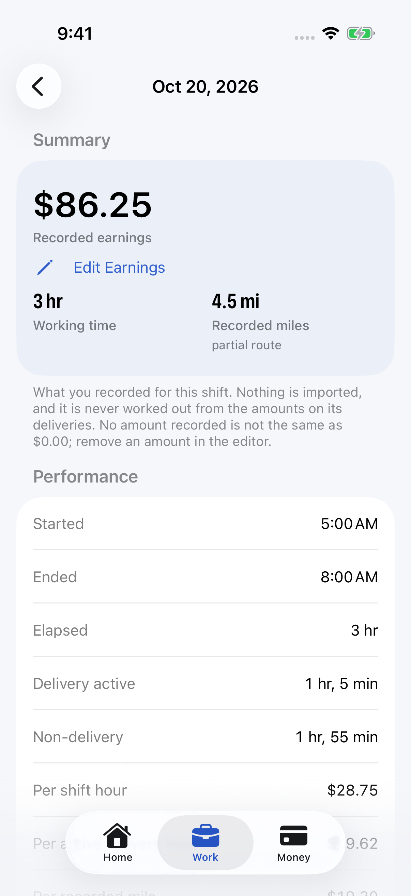{ width="200" }

Active work and preferences:

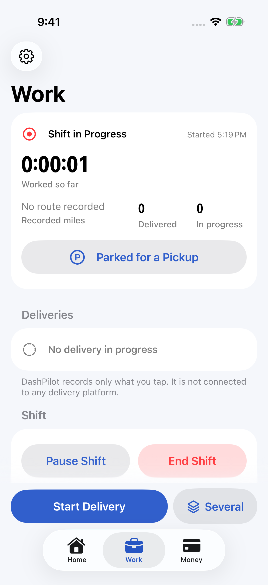{ width="200" }
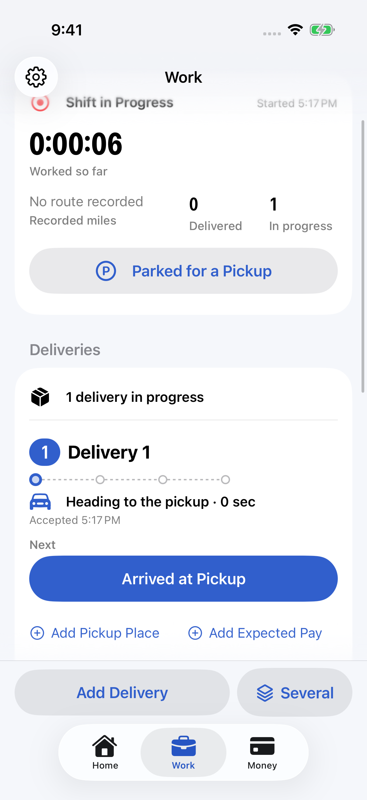{ width="200" }
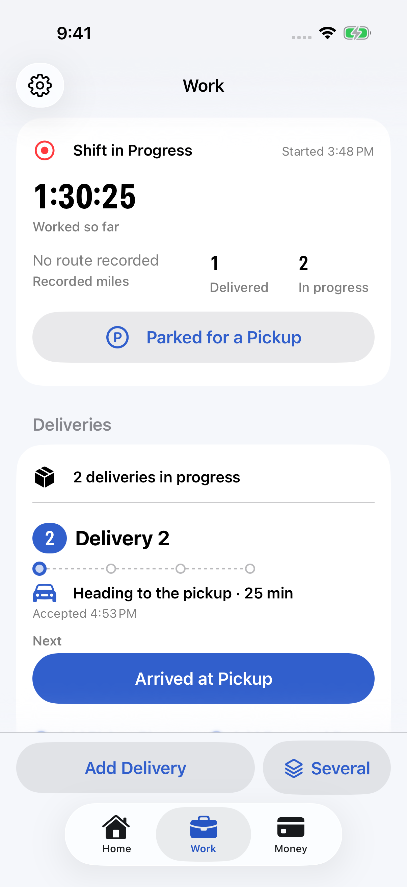{ width="200" }
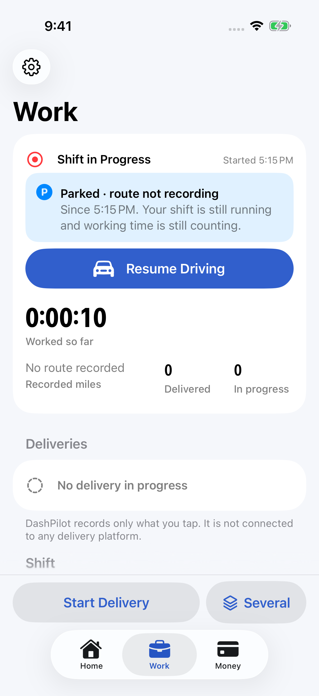{ width="200" }
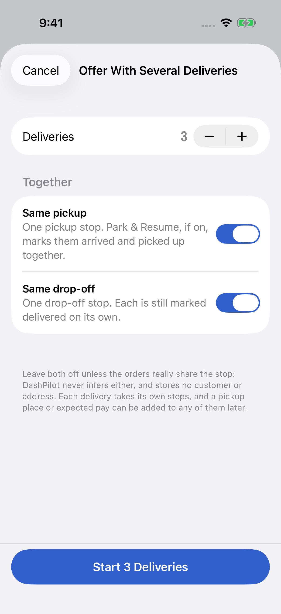{ width="200" }
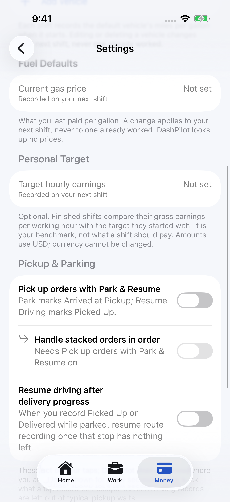{ width="200" }

## Continuous integration

CI builds both test bundles and runs both suites on every pull request and every push to `main`. A
release should be cut only from a commit whose CI run is green. The serial job's budget is 90 minutes
for the build and both full suites; see
[How long a run takes](testing.md#how-long-a-run-takes-and-the-budget-it-is-given).

## Before tagging

1. Open the pull request for the release branch and require CI green.
2. Preserve application identifiers and complete the declared iPhone and iPad device checks.
3. Reconcile `MARKETING_VERSION` and the build number with the approved release and submission history.
4. Review the archive privacy report and current submission requirements against actual API use.
5. Run the app on a physical iPhone through one real shift, including the Lock Screen card and a
   background stretch, which no automated test can do.
6. Obtain explicit approval before tagging, publishing, deploying or submitting anything. CI does not authorize release actions.
