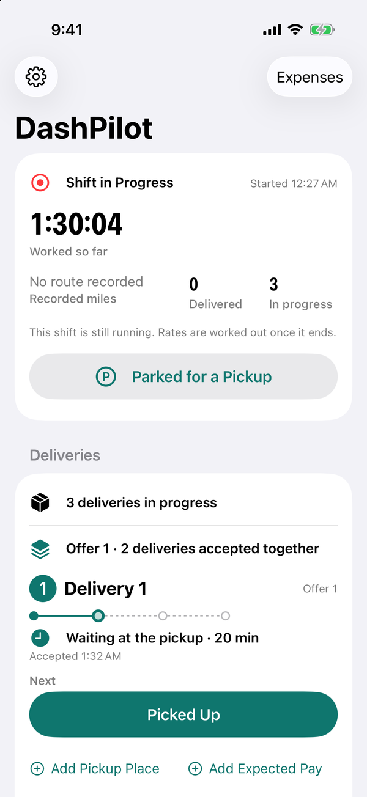

# Release readiness

This checklist is for a separately authorized release-readiness interval. Repository tags
`v0.1.0` and `v0.1.1` exist; the current source has moved beyond them. This page does not establish
App Store Connect or TestFlight submission status, and documentation validation does not release anything.

## Identity and version

| Item | Current value | Status |
| --- | --- | --- |
| Display name | `DashPilot` (`INFOPLIST_KEY_CFBundleDisplayName`) | Ready |
| App bundle identifier | `quang.DashPilot` | Decide before the first upload; see below |
| Widget extension identifier | `quang.DashPilot.Widgets` | Follows the app's |
| Marketing version | `1.0` (Xcode's default, never chosen) | Reconcile with the next approved release version |
| Build number | `1` (`CURRENT_PROJECT_VERSION`) | Ready for a first build |
| Deployment target | iOS 26.5, all targets | Ready |
| Device family | iPhone and iPad (`TARGETED_DEVICE_FAMILY = 1,2`) | Decide; see below |
| Signing team | set in the project; no signing in CI | Unchanged by design |

**Version.** The repository has `v0.1.0` and `v0.1.1` tags, while Xcode still declares `1.0`.
Reconcile that mismatch in the release-readiness interval. No version, tag or release is changed
by the onboarding and documentation interval.

**Bundle identifier.** `quang.DashPilot` is accepted by App Store Connect, but it is not reverse
DNS, and an identifier cannot change after the first upload without becoming a different app.
Decide it before the first TestFlight build, not after.

**iPad.** The app declares iPad support and every iPad orientation, while every journey and every
screenshot is iPhone portrait. A store submission that keeps iPad needs iPad screenshots and an iPad
layout check; one that drops it should set `TARGETED_DEVICE_FAMILY = 1`.

## Assets and appearance

- **App icon:** one 1024-point universal icon with dark and tinted variants
  (`Assets.xcassets/AppIcon.appiconset`). Ready.
- **Launch appearance:** generated (`UILaunchScreen_Generation`), the system background. Ready.
- **Typeface:** the system face; neither the app nor the widget bundles a font
  (`FontBundleInvariantTests`).
- **Accent:** teal `AccentColor` with a dark variant.

## Capabilities and configuration

| Capability | Where it is declared | Status |
| --- | --- | --- |
| Location, When In Use | `NSLocationWhenInUseUsageDescription` | Ready. No Always key exists, by design |
| Background location | `UIBackgroundModes = [location]` in `DashPilot/Info.plist`, the only mode | Ready |
| Live Activities | `NSSupportsLiveActivities = YES` in `DashPilot/Info.plist` | Ready. No push, no entitlement needed |
| Widget extension | `DashPilotWidgets.appex`, embedded by the app target | Ready |
| App Intents | nine discoverable intents, nine App Shortcuts; eight Live Activity intents, not discoverable | Ready |
| Entitlements | none; no App Group, no iCloud, no push | Ready |

The location purpose string says what the app does and no more: it records the route of a shift the
driver started, keeps recording while they use other apps or the screen is locked, and keeps the
route on the device. **A store reviewer will ask why a background mode is declared**; the answer is
the one in [Location](../architecture/location.md): capture started with the app open continues off
screen, and nothing starts or relaunches the app in the background.

## Privacy, as a submission would describe it

Every statement below is true of the code as it stands. None is broader than the implementation.

- **Accounts:** none. There is no sign-in and no server.
- **Network:** DashPilot contains no networking code. Nothing it records leaves the device except
  in a file the driver exports and shares themselves.
- **Analytics, telemetry, advertising, tracking:** none. No third-party SDK of any kind.
- **Data stored on the device:** shifts and their times, pauses and parked stretches, deliveries and
  their lifecycle times, the route positions captured while a shift runs, pickup-place names the
  driver typed, earnings, tips, expected pay and expenses the driver entered, vehicle profiles and a
  gas price. All of it is in the app's own SwiftData store.
- **Location:** used only while a shift the driver started is running, When In Use only, continuing
  in the background once started with the app open. Positions are stored to measure recorded
  mileage; the standard export carries distances and never coordinates.
- **Live Activity:** shows the shift's state, working time, recorded mileage, counts and each open
  delivery's clock. It shows no amount, no pickup name, no address and no coordinate, because a Lock
  Screen can be read by anyone beside the phone.
- **App Intents:** perform the same lifecycle actions as the buttons, against the same local store.
  Nothing is donated to the system.
- **Export:** JSON and CSV, written only when the driver asks, handed to the system share sheet,
  and removed from the temporary directory at the next launch.
- **App Privacy label:** with nothing collected (in Apple's sense, sent off the device), the label
  would be "Data Not Collected". Confirm against the questionnaire at submission time.
- **Privacy manifest:** no `PrivacyInfo.xcprivacy` is present. Onboarding uses `UserDefaults` for
  its completion record. The earlier claim that the app uses no required-reason API was stale.
  Review the current Apple requirements and the app's actual API use before submission; this
  documentation interval makes no privacy-manifest or submission-compliance claim.

## Product positioning

DashPilot is a local-first companion for delivery drivers on any platform. It is not affiliated with
DoorDash or any other delivery platform, it does not read, scrape or automate any delivery app, and
the in-app wording is platform neutral (see [Platform terminology](platform-terminology.md)). The
README, the docs and the Acknowledgements screen name DoorDash only to disclaim an integration.
**The name contains "Dash"**, which a reviewer or a platform could read as an association; that is a
naming decision for the owner, recorded here rather than made here.

## Licenses

DashPilot's source is MIT (`LICENSE`). The app has no third-party runtime dependency and bundles no
font, so the Acknowledgements screen lists the MIT license and the system typeface and nothing
else. The documentation toolchain (MkDocs) is a build-time dependency only.

## Documentation and screenshots

- README is a concise introduction with two existing screenshots and links into this site.
- The screenshots are simulator captures of synthetic fixture data, taken by UI journeys
  (`attachScreenshot`) on iPhone 17 with the status bar set to 9:41. No real earnings, places,
  restaurants, customers or routes appear in any of them.
- A release-notes draft is in [Release notes draft](release-notes-draft.md).

Existing synthetic captures, retained for reference. Some predate Home / Work / Money and the
current financial layouts. Replace the permanent set only in the release-readiness interval:

{ width="200" }
{ width="200" }
{ width="200" }
{ width="200" }
{ width="200" }
{ width="200" }
{ width="200" }
{ width="200" }

## Continuous integration

CI builds both test bundles and runs both suites on every pull request and every push to `main`. A
release should be cut only from a commit whose CI run is green. The serial job's budget is 90 minutes
for the build and both full suites; see
[How long a run takes](testing.md#how-long-a-run-takes-and-the-budget-it-is-given).

## Before tagging

1. Open the pull request for the release branch and require CI green.
2. Decide the bundle identifier and whether iPad is supported.
3. Reconcile `MARKETING_VERSION` and the build number with the approved release and submission history.
4. Review current privacy-manifest requirements against actual API use, including `UserDefaults`.
5. Run the app on a physical iPhone through one real shift, including the Lock Screen card and a
   background stretch, which no automated test can do.
6. Tag the release commit; nothing in this repository tags or publishes automatically.
